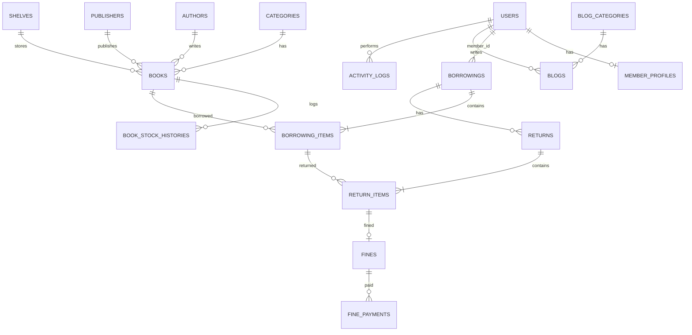

# BroSeven Library

Sistem informasi manajemen perpustakaan berbasis web: katalog publik, peminjaman dan pengembalian dengan
stok yang aman, denda otomatis, kartu anggota ber-QR, blog, serta laporan Excel dan PDF.

**Teknologi:** Laravel 13, PHP 8.3+, MySQL, Blade, Bootstrap 5 (lokal), JavaScript murni, Chart.js (lokal),
Laravel Excel, DomPDF, bacon/qr-code. Tanpa CDN, React, Vue, Livewire, atau Tailwind.

## Fitur per role

| Role | Kemampuan utama |
|---|---|
| **Tamu** | Beranda dinamis, katalog dengan pencarian dan filter, blog, tentang, kontak, registrasi anggota |
| **Anggota** | Katalog, mengajukan dan membatalkan peminjaman, riwayat peminjaman dan pengembalian, denda, kartu anggota (PDF, cetak, QR), profil |
| **Admin Karyawan** | Menyetujui atau menolak pengajuan, pengembalian dan denda otomatis, pembayaran denda, buku dipinjam, data anggota, bukti cetak PDF |
| **Admin Master** | Buku, kategori, penulis, penerbit, rak, stok |
| **Super Admin** | Semua di atas, ditambah pengguna, pembebasan denda, profil perpustakaan, blog, laporan, log aktivitas |

## Instalasi (development, Windows 11 + PowerShell)

```powershell
git clone <repo> broseven-library
cd broseven-library
composer install
copy .env.example .env
php artisan key:generate
# Buat database MySQL "broseven_library" (utf8mb4), lalu isi DB_* di .env
php artisan migrate --seed
php artisan storage:link
php artisan serve
```

Buka `http://127.0.0.1:8000`. Perintah `php artisan schedule:work` menjalankan penandaan keterlambatan harian.

### Akun development (hanya `local`, jangan dipakai di production)

| Role | Username | Password |
|---|---|---|
| Super Admin | `superadmin` | `Password123!` |
| Admin Master | `adminmaster` | `Password123!` |
| Admin Karyawan | `adminkaryawan` | `Password123!` |
| Anggota | `budi.santoso`, `siti.rahayu`, `andi.pratama`, `dewi.lestari`, `rizky.maulana` | `Password123!` |

Di production seeder **tidak** membuat akun. Gunakan `php artisan library:install`.

## Perintah khusus

| Perintah | Fungsi |
|---|---|
| `php artisan library:install` | Membuat Super Admin pertama dan data awal (production) |
| `php artisan library:mark-overdue` | Menandai peminjaman lewat jatuh tempo (dijadwalkan harian 00:05) |
| `php artisan test` | Menjalankan seluruh test |
| `vendor\bin\pint` | Merapikan gaya kode |

## Aturan bisnis penting

- Pengajuan **tidak** mengurangi stok. Stok berkurang saat petugas menyetujui, dalam satu transaksi dengan penguncian baris. Persetujuan gagal sebagian dibatalkan seluruhnya.
- Stok selalu konsisten: `total = tersedia + dipinjam`, tidak pernah minus (dijaga aplikasi dan CHECK constraint).
- Jatuh tempo = tanggal persetujuan + durasi di Profil Perpustakaan.
- **Denda = hari terlambat × denda per hari** per buku, berdasarkan tanggal kalender. Tarif dan hasilnya disimpan di tiap pengembalian sehingga perubahan tarif tidak mengubah riwayat.
- Pengembalian tidak bisa diproses dua kali. Pembebasan denda hanya oleh Super Admin.
- Data yang punya riwayat dihapus secara *soft delete*; buku, pengguna, atau master yang masih dipakai tidak dapat dihapus.

## ERD ringkas



## Struktur kode

```text
app/Http/Controllers/{Auth,Guest,SuperAdmin,AdminMaster,AdminKaryawan,Anggota}
app/Services      Aturan bisnis: BorrowingService, ReturnService, FineService, BookStockService, ReportService, ...
app/Support       Menu, Panel, ReportFilters, Format, PdfAssets
app/Exports       BorrowingExport, ReturnExport
app/Policies      BorrowingPolicy (gate lain di AppServiceProvider)
resources/views   layouts, components, guest, super-admin, admin-master, admin-karyawan, anggota, pdf, profile
tests             Feature dan Unit, trait bantu di tests/Concerns
```

Controller master data dan transaksi dipakai bersama oleh beberapa role. Awalan route dan layout ditentukan oleh `App\Support\Panel`.

## Keamanan

Middleware peran dan status aktif di setiap route, gate dan policy di controller, validasi lewat Form Request, proteksi IDOR
(anggota hanya melihat datanya sendiri), password di-hash, pembatas laju login dan registrasi, header keamanan (CSP tanpa asal
eksternal, X-Frame-Options, dsb.), upload dibatasi tipe, ukuran, dan dimensi dengan nama file acak, token QR acak 64 karakter,
perlindungan formula injection pada Excel, dan audit log aktivitas penting.

## Pengujian

`php artisan test` menjalankan semua test (database SQLite in-memory). Test mencakup seluruh daftar pengujian di spesifikasi,
skenario menyeluruh `FullLifecycleTest`, efisiensi query (`QueryEfficiencyTest`), dan keamanan (`SecurityTest`).

Panduan deployment: lihat [docs/DEPLOYMENT.md](docs/DEPLOYMENT.md).
